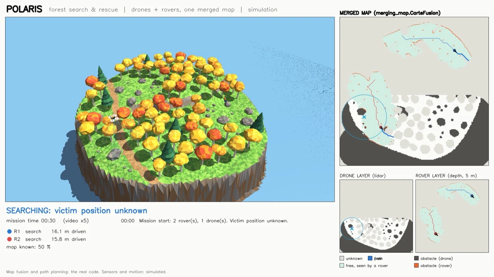
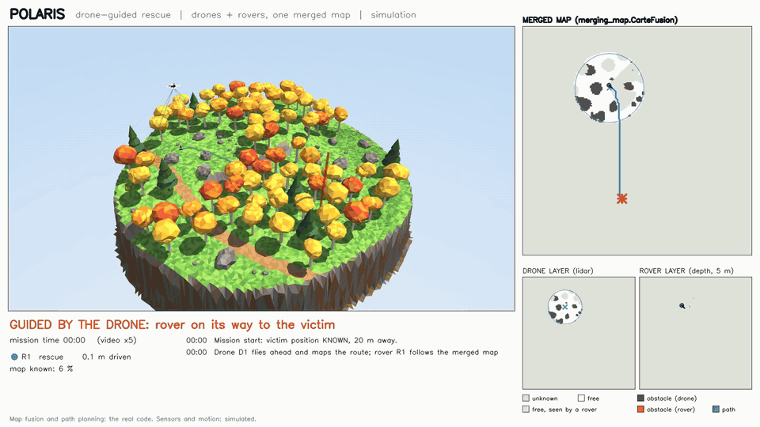
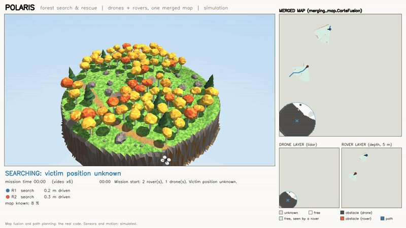
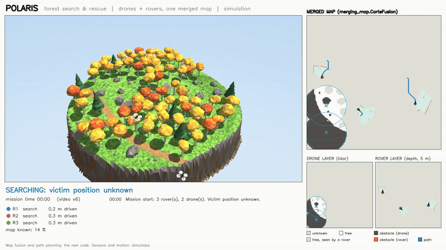
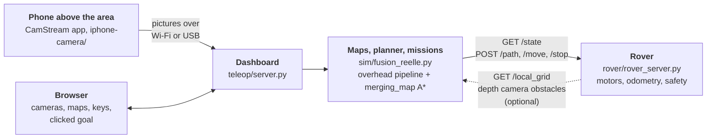
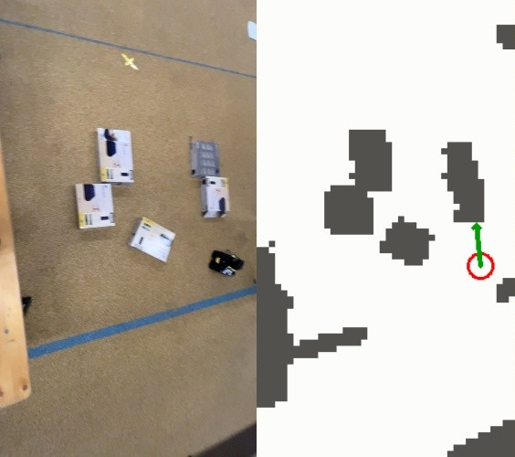
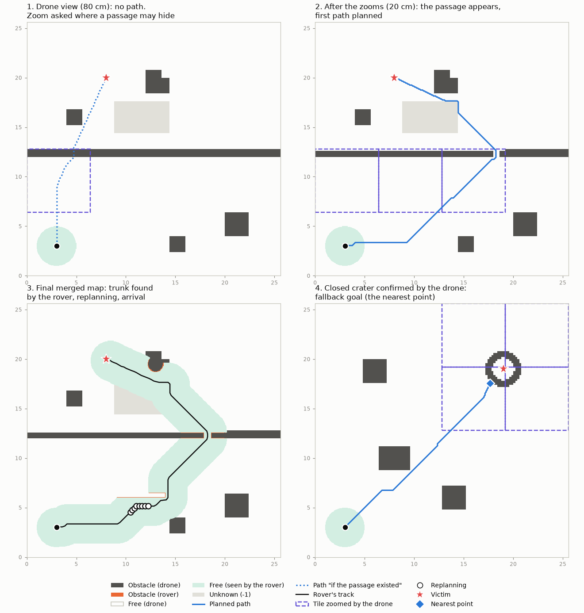

# Polaris: a drone guides a rover

Hackathon proof of concept (Leukerbad, November 2026). A camera looking down from above, a
drone or a phone on a mount, sees the whole area, maps the obstacles and locates the rover. A
planner turns that map into a path, and a small ground rover (Waveshare RaspRover) drives it,
with its own depth camera for what the overhead view misses. Everything runs on one laptop
plus the rover; the demo chain is plain Python, with no ROS required.



*Search-and-rescue mission in simulation: two rovers and one drone fill one merged map
(`merging_map.CarteFusion`). Map fusion and path planning are the real code; sensors and
motion are simulated.*

- [Vision](#vision)
- [How it works](#how-it-works)
- [Quick start](#quick-start)
- [What is proven](#what-is-proven)
- [Repository map](#repository-map)
- [ROS 2 workspace](#ros-2-packages)
- [Tests and lint](#tests-and-lint)
- [Known limits](#known-limits)
- [Team](#team)

## Vision

What we built and drove during the hackathon is one rover guided by one camera above it. The
goal behind it is larger: **a swarm of ground and aerial robots that scout an area together,
each at its own scale, into one shared map.** Drones see wide and coarse from above, rovers
see close and fine on the ground, and each robot is sent where the others cannot see.

| Use case | How the swarm would work |
|---|---|
| **A missing person in a forest** | Drones map the clearings and the tree line from above; rovers go under the canopy, where no drone can see, and the merged map shows what is left to search. |
| **Victims of a house fire** | A drone with a thermal camera and a ground robot map the rooms together and locate people before anyone goes in. |
| **Any area to scout before people enter it** | The same map and planner, with other robots and sensors plugged in. |

What already points that way in this repository:

- **One map for any number of robots, at several scales.** The fused map takes tiles from
  every source, from 80 cm cells (a drone's first survey) down to 5 cm (a rover). The finest
  and most recent view wins, and a rover's view wins over a drone's
  ([merging_map/](merging_map/README.md)).
- **Any device can be plugged in.** A JSON file lists the drones, rovers and sensors around
  that map; the example runs two drones and two rovers in simulation
  ([devices/](devices/README.md)).
- **A forest search in simulation**, with any number of rovers and drones and any 3D terrain:
  the picture above, made by [sim/mission/](sim/mission/demo_video.py).

What is not there yet: on real hardware the system has run with one rover and one phone
standing in for the drone. Several robots at once exist only in simulation, and no thermal
camera has been used.

### Why drones and rovers, not drones alone

In a forest a drone maps a large area in minutes, but **it cannot see under the trees** and
**it cannot bring equipment** (a radio, water, a first-aid kit) to someone on the ground. A
rover can do both, but it only sees a few metres ahead and would search blindly. On one shared
map each does what the other cannot: the drone gives the big picture and the way around large
obstacles, the rover fills in what is hidden under the canopy and goes to the person.



*The victim's position is known: the drone flies ahead of the rover and maps the route. It sees
the rock step from above, so the rover is sent around it from the start; the rover adds what is
hidden under the crowns. When nobody knows where the victim is (picture at the top), drones
survey the open ground and rovers search under the trees.*

| Nobody knows where the victim is: a rover finds it under the trees | Three rovers and two drones: a drone spots it in the open |
|---|---|
|  |  |

*Left: the drone has mapped the open ground and the victim is still missing; a rover searching
under the canopy finds it and drives to it. Right: the same code with three rovers and two
drones; a drone spots the victim and the nearest rover is sent on the merged map. Videos are
sped up five to six times.*

The same code runs from simulation to the real robot: the map fusion and the planner in these
pictures are the ones that drove the real rover ([What is proven](#what-is-proven) says what
ran on hardware and what only in tests). In the simulation the terrain is a generated stand-in
and the sensors, the detection of the victim and the robots' motion are simulated. To make
these videos (needs `mujoco`, `trimesh`, `opencv-python`, `pillow`, `imageio-ffmpeg`, the rover
meshes in `ROVER_MESHES` and a drone model in `DRONE_DIR`: the script's header says which):

```bash
python sim/mission/terrain_gen.py out/forest.glb          # or bring your own 3D model
python sim/mission/terrain.py out/forest.glb out/forest   # model -> maps, safe start points
MUJOCO_GL=egl python sim/mission/demo_video.py out/forest out/search.mp4 --rovers 3 --drones 2
MUJOCO_GL=egl python sim/mission/demo_video.py out/forest out/guided.mp4 --rovers 1 --drones 1 --known
```

## How it works



1. **Drone map.** The overhead picture is resampled to a metric top view; pixels that differ
   from the floor around them become obstacles on a grid of 5 cm cells
   (`src/guidance_global_map`). The rover is found by the AprilTag on its top, or by a vision
   model.
2. **Planning.** `merging_map/` stores the map tiles of the drone and the rover, fuses them and
   plans with A*, keeping 15 cm between the rover's centre and any obstacle.
3. **Driving.** `sim/fusion_reelle.py` sends the path to the rover's HTTP server, which runs
   the motors, the odometry and the safety stops.
4. **Local map (optional, off by default).** The rover's depth camera (Intel RealSense D405)
   adds the obstacles near the rover as a second layer, and a guard on the rover can slow it
   down and stop it before what it sees.
5. **Dashboard.** `teleop/` shows the cameras and the three maps (rover, drone, fused) in a
   browser, drives the rover from the keyboard and sends it to a clicked goal.

| From above, on the real floor | Map fusion and planning |
|---|---|
|  |  |
| A picture from the phone above the arena and the obstacle grid computed from it. The red circle is where the rover was found. | Output of `merging_map/demo_fusion.py` on a simulated world: the coarse drone view shows no path, the drone zooms where a passage may hide, the rover finds a fallen trunk and replans, and a goal that cannot be reached is replaced by the nearest point. |

The ROS 2 Jazzy nodes in `src/` publish the same overhead map on topics; the demo chain does
not go through them.

## Quick start

**Run the tests (no hardware, no ROS)**

```bash
pip install opencv-contrib-python numpy pytest
scripts/test_fast.sh
```

**Try the overhead pipeline on one photo**

```bash
export PYTHONPATH=src/guidance_calib:src/guidance_global_map
python -m guidance_global_map.segment_image photo.jpg out/scene --camera-height 1.9
```

This writes the obstacle overlay, the map drawn cell by cell and the grid as numbers (see
[Overhead camera](#overhead-camera)).

**Run the whole chain on a Mac, with the rover and the phone on the same network**

```bash
ROVER=http://<rover address>:8080 PHONE=http://<phone address>:8080/stream scripts/mac/run_local.sh start
scripts/mac/run_local.sh status
scripts/mac/run_local.sh stop
```

Then open `http://localhost:8082`. The script starts the dashboard (8082), the perception
service (8095), the map fusion (8096) and the 3D mapper (8081); it never sends a motor command
by itself, and `stop` only ends the local processes. Its settings are environment variables,
listed at the top of [scripts/mac/run_local.sh](scripts/mac/run_local.sh). What each side needs
first:

| Side | Setup |
|---|---|
| Rover | `rover/rover_server.py` running on the rover: [rover/README.md](rover/README.md) |
| Phone | The CamStream app serving its camera: [iphone-camera/README.md](iphone-camera/README.md) |
| Mac | The Python environment of the mapper (PyTorch): [rover_mapper/README.md](rover_mapper/README.md) |

The step-by-step guide for a real run is [docs/demo-reelle.md](docs/demo-reelle.md). The
settings that decide what the rover does are in [docs/state.md](docs/state.md).

## What is proven

Taken from [docs/state.md](docs/state.md), which has the full table and is the file to read
first.

| Part | Evidence |
|---|---|
| Global navigation from the overhead camera, rover located by its tag, local map off | Seen working live by the team |
| Smaller obstacle growth (15 cm keep-out, 15 cm steps, shadows removed) | Seen working live by the team |
| Obstacle detection from above | Seven real photos of the floor mock-up |
| Reading the rover's tag (AprilTag 25h9, id 10) | One real photo |
| Vision model that finds the rover from above | 17 real pictures, by its author |
| Local navigation with the rover's depth camera, first version | Driven on the robot: overprotective (rover standing still, phantom obstacles) |
| Local navigation, reworked (confirmed obstacles, guard the width of the body, the two maps as layers) | Tests only, not on the robot |
| The rover clears the drone's false obstacles (`--clear-drone`, off by default) | Tests only, not on the robot |
| Drone map placed by the rover's move, without a tag | Tests only, with rendered pictures |
| ROS nodes (`/map`, `/rover/pose_overhead`, `merging_map_node`) | Run in the container on one photo; not part of the demo chain |

## Repository map

| Folder | What it is |
|---|---|
| [sim/](sim/README.md) | `fusion_reelle.py`, the heart of the demo (maps, planner, missions), and the MuJoCo simulation of the rover and a drone |
| [merging_map/](merging_map/README.md) | Drone + rover map fusion, A* planner, what to do when the rover is blocked |
| [teleop/](teleop/README.md) | Web dashboard: driving, cameras, maps, missions |
| [rover/](rover/README.md) | The server that runs on the rover (motors, odometry, safety, depth grid, guard) and its test bench |
| [rover_mapper/](rover_mapper/README.md) | Live 3D map from the rover's single camera (Depth Anything 3) and the perception service |
| [iphone-camera/](iphone-camera/README.md) | CamStream, the iPhone app that serves the overhead camera |
| [devices/](devices/README.md) | Plug any drone, rover or sensor around the one fused map, from a JSON file |
| `src/` | ROS 2 Jazzy packages: overhead calibration, global map, rover pose, bridges, bringup |
| [docs/](docs/state.md) | [state.md](docs/state.md) (what runs today), [overhead-camera.md](docs/overhead-camera.md), [local-navigation.md](docs/local-navigation.md), [demo-reelle.md](docs/demo-reelle.md) |
| `scripts/` | `test_fast.sh` and `mac/run_local.sh` |
| [camera-stabilization-test/](camera-stabilization-test/README.md), `camera-test/` | Standalone camera experiments |
| `data/` | A generated overhead scene for the marker setup |

## ROS 2 packages

| Package | Build type | Purpose |
|---|---|---|
| `guidance_interfaces` | ament_cmake | Custom msg/srv/action definitions (empty for now; rosidl needs CMake) |
| `guidance_calib` | ament_python | Overhead camera calibration, image → ground plane mapping |
| `guidance_global_map` | ament_python | Overhead image → `nav_msgs/OccupancyGrid` on `/map` |
| `guidance_rover_pose` | ament_python | Rover pose in the map frame from the overhead camera |
| `guidance_rover_vo` | ament_python | Bridge from the rover mapper: visual odometry and local 3D points |
| `guidance_supervisor` | ament_python | `merging_map_node`: the map fusion and its planner on ROS topics. `supervisor_node` (goals, mission state, health checks) is still a placeholder |
| `guidance_bringup` | ament_python | `guidance.launch.py` and `config/` for parameters |

Nav2 and robot_localization are not wired up: configuring Nav2 in `guidance_bringup` is still
a TODO. Today the planner is `merging_map`'s A*, and local obstacle avoidance is the rover's
own guard ([docs/local-navigation.md](docs/local-navigation.md)).

## Rover mapper bridge (`guidance_rover_vo`)

The rover mapper builds a live 3D map from the rover's single camera (Depth Anything 3) and shows
the rover in third person. It needs the host GPU (Apple Metal), so it runs natively on the host,
not in the container. It streams the rover state over TCP on port 7400; `rover_vo_bridge_node`
connects to `host.docker.internal:7400` and publishes:

| Topic / TF | Type | Frame | Content |
|---|---|---|---|
| `/rover/vo/odom` | `nav_msgs/Odometry` | `odom` → `base_link` | x, y, yaw of the rover body; not published while the mapper is lost |
| `/rover/points` | `sensor_msgs/PointCloud2` | `base_link` | 3D points in front of the rover, people and other moving objects removed |
| TF `odom → base_link` | | | only if `publish_tf` is true (default, until the EKF publishes it) |

The mapper's `odom` frame is its own (x forward at start, y left, z up, metres, floor at z = 0);
it never publishes `map`, which belongs to the overhead camera. Known limits: metric scale from
the floor is only about ±15% accurate so far; the pose can jump once or twice in the first
seconds while the mapper calibrates (logged); the cloud includes the floor, so set
`min_obstacle_height` in the costmap. Parameters: `host`, `port`, `odom_frame`, `base_frame`,
`publish_tf`. Wire format: `guidance_rover_vo/protocol.py`. `guidance.launch.py` starts it only
with `rover_vo:=true`, so launches that do not use the mapper are unchanged.

The mapper itself is in `rover_mapper/` (`run.py`, see its README; plain Python with PyTorch,
outside the container). `teleop/` is the web dashboard used with the real rover: keyboard
driving through `rover/rover_server.py` next to the mapper's live 3D view (see `teleop/README.md`).

## Dev environment

The Docker image is based on the official `ros:jazzy` image and adds cv_bridge, image_publisher,
OpenCV, matplotlib, pytest and ruff. Nav2 and robot_localization are left out by default, since
nothing uses them yet and they are most of the download: add `--build-arg WITH_NAV2=1` to
`docker build` to get them.

**Fast test loop** (about half a minute, no `colcon build`): the plain-Python tests of the
overhead camera, the map fusion and the dashboard's maps.

```bash
docker run --rm -v "$PWD":/ws polaris-dev scripts/test_fast.sh           # from the host
scripts/test_fast.sh -k scale                                            # in the container
```

**VS Code:** open the folder and run *Dev Containers: Reopen in Container*. The first start runs
`rosdep install` and `colcon build`.

**Plain Docker:**

```bash
docker build -t polaris-dev .
docker run -it --rm --add-host=host.docker.internal:host-gateway -v "$PWD":/ws polaris-dev bash
```

Camera passthrough is not set up yet. On a Linux host add `--device=/dev/video0` (see the TODO in
`.devcontainer/devcontainer.json`). On Windows, USB cameras need `usbipd-win` to reach WSL2 first.

## Build and run

Inside the container, from `/ws`:

```bash
rosdep install --from-paths src --ignore-src -y -r
colcon build --symlink-install
source install/setup.bash

# all nodes
ros2 launch guidance_bringup guidance.launch.py
ros2 launch guidance_bringup guidance.launch.py log_level:=debug

# a single node
ros2 run guidance_global_map global_map_node
```

## Overhead camera

The overhead camera is fixed and looks straight down at the floor. Its image arrives on
`/overhead/image_raw`. No markers are needed, on the floor or on the rover.

| Node | Publishes | How |
|---|---|---|
| `calib_node` | `/overhead/image_to_map` (3x3 homography, row-major, latched) | Scale from the camera height and the lens. The map origin is the image's bottom-left corner, x right, y up. |
| `global_map_node` | `/map` (`nav_msgs/OccupancyGrid`), `/rover/pose_overhead` (`geometry_msgs/PoseWithCovarianceStamped`), debug images `/overhead/debug/top_down` and `/overhead/debug/mask` | Resamples the image to a metric view at 5 mm. Pixels whose colour differs from the floor around them are obstacles. The obstacle blob that has the rover's size is the rover: its cells are marked on the map and its position is published. The map is a grid of 5 cm cells; a cell that an obstacle touches anywhere is occupied. |
| `rover_pose_node` | nothing in this setup | Only used with a marker on the rover (see below). |

All parameters are in `src/guidance_bringup/config/overhead.yaml`. The ones to set for a new
setup:

- `camera_height`, and `focal_length_35mm` with `sensor_width_px` / `sensor_height_px` for the
  camera. The defaults are an iPhone 12 Pro Max main-camera photo. The image may be cropped but
  not resized, and video has a different scale than photos.
- `rover_size`: the rover as it appears from above, cables and shadow included. Measure it on a
  photo with the tool below. No other object in view may have the same size.
- `color_threshold` and `floor_window`: tune while watching `/overhead/debug/mask`.
- `cell_size`: the size of a map cell. `margin`: extra blocked cells around obstacles, off by
  default.

Map cell values: 0 free, 100 obstacle, 50 the rover itself, 99 margin, -1 not seen by the
camera. The value 50 is not a standard occupancy value: a planner has to treat those cells as
its own start, not as a cost.

**Trying a photo without ROS**

```bash
pip install opencv-contrib-python numpy
export PYTHONPATH=src/guidance_calib:src/guidance_global_map
python -m guidance_global_map.segment_image photo.jpg out/scene --camera-height 1.9
```

This writes `out/scene_overlay.jpg` (obstacles red, rover blue, each blob labelled with its size
in centimetres), `out/scene_grid.png` (the map drawn cell by cell: white free, grey obstacle, blue rover)
and the map as numbers in `out/scene_grid.csv` and `out/scene_grid.npy`, row 0 at y = 0.
This is the same grid that `/map` carries. `out/scene_fusion.npy` is that grid in the value
convention of the map fusion (`merging_map`): 1 obstacle, 0 free, -1 not seen.

The whole pipeline, its outputs, what has been verified and what comes next are described in
[docs/overhead-camera.md](docs/overhead-camera.md). What runs today, how well each part
is proven and the settings that matter are in [docs/state.md](docs/state.md).

**Running a saved photo or video through the nodes**

```bash
ros2 launch guidance_bringup guidance.launch.py overhead_source:=/ws/data/overhead/photo.jpg
```

**Marker setup (test rig, or a tilted camera).** Set `mode: markers`, `rover_detection: marker`
and `detection: marker` in the config. Print the markers with `ros2 run guidance_calib
generate_markers --out markers` (ids 0-3 for the floor, 10 for the rover, AprilTag family `DICT_APRILTAG_25h9`). Tape
0-3 at the corners of a measured rectangle and enter their positions as `marker_x` / `marker_y`;
fix 10 on the rover with its top edge facing forward. This also gives the rover's heading.
`data/overhead/synthetic_scene.png` is a generated scene for this setup.

**Known limits of the baseline**

- The rover's heading is unknown without a marker. It has to come from the rover's motion
  between frames, which is not done yet.
- The rover is recognised by size alone. An obstacle of the same size, or the rover touching an
  obstacle, breaks it.
- Scale from the height assumes the camera looks exactly straight down and the ground is flat.
- Tall obstacles lean away from the point under the camera, so they look larger than they are.
- Shadows count as obstacles. An obstacle the colour of the floor is missed. A person in view
  is mapped as an obstacle.
- Lens distortion is not corrected: use the phone's main lens, not the ultrawide.

## Tests and lint

```bash
scripts/test_fast.sh                                             # plain Python, about 270 tests
docker run --rm -v "$PWD":/ws polaris-dev scripts/test_fast.sh   # the same, in the dev container
colcon test && colcon test-result --verbose                      # ROS packages, after colcon build
ruff check . && ruff format --check .
```

`scripts/test_fast.sh` covers the overhead camera, the map fusion, the real-rover chain against
a simulated rover and the rover's local map and guard. The `teleop` and `rover_mapper` tests
need `requests` and `torch` on top. One test,
`test_a_small_blurred_tag_is_read`, depends on the OpenCV version: it fails with OpenCV 4.11.

## Known limits

- Scenes are small and crowded: with 15 cm of keep-out the rover needs 30 cm between obstacles.
- Without the local map and with the rover's guard off (the defaults), an obstacle the overhead
  camera misses is found only by bumping into it.
- Placing the drone map by the rover's move needs a still camera between the two stops.
- A change of lens, resolution or stabilisation mode on the phone changes the scale: let the
  system measure it again (tag or move), never reuse an old number.
- The reworked local navigation and the clearing of false drone obstacles have only run in
  tests, not on the robot.

The limits of the overhead pipeline itself are listed [above](#overhead-camera), and the open
decisions in [docs/state.md](docs/state.md).

## Team

Built during the hackathon by Shah1st, Pacotiber, RBDRB, Romaindcrl, Fawzi, Oleksandr Pitenko
and Svietozar Pliekhov (names from the git history), with Claude as coding agent. Notes for
coding agents are in [AGENTS.md](AGENTS.md).
