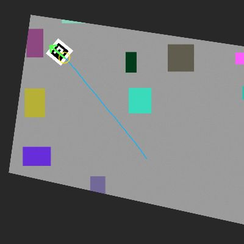

# air_ground — guiding the rover from a camera that moves

Experiment (branch `experiment`): a simpler chain for the air-ground link. The air camera (an
iPhone today, a drone later) knows its own pose, the way a real drone does, and sends it with
every picture. Everything is then measured in ONE frame fixed to the floor, whatever the
camera's movements: the rover, the obstacles, the goal. Plain Python (numpy, OpenCV), no ROS.

```
iPhone (CamStream, ARKit mode)  --/stream: JPEG + X-Pose-->  camstream.py    picture + pose
                                                             pose_camera.py  pixels <-> metres
                                                             rover_marker.py the rover: x, y, heading
                                                             floor_map.py    the grid, built from the video
                                                             planner.py      the team's A* around obstacles
rover (rover/rover_server.py)   <--GET /state, POST /path--  guidance.py     floor <-> odometry, steering
you, in a browser               --click on the map-->        guide_rover.py  the loop and its page
```

**The grid** (`floor_map.py`): the phone moves, the grid does not. Every picture is laid on the
floor with the pose sent with it, into one grid fixed to the floor, in the team's format (5 cm
cells, `1` obstacle / `0` free / `-1` unknown, row 0 = south; `GET /map.json`). An obstacle is:

* what the team's colour detection sees (`guidance_global_map.segment_obstacles` on the floor's
  picture, then the shadow and thin-line filters of `sim/fusion_reelle.py`): a plain box, a dark
  bag; it cannot tell a flat colour on the floor (rug, tape, paint) from an object
  (`--no-colour` leaves it out);
* what stands higher than 4.5 cm: what stands up shifts between two views laid on the floor,
  the floor does not (plane sweep over pairs of views a few tens of cm apart); it sees what has
  the floor's colour, but needs texture and many views taken while moving.

What the camera sees again **replaces** what was said of a cell, it is not added to it (the
team's `--drone-cumul` rule): each view, or pair of views for the heights, says "obstacle",
"floor" or nothing for each 5 cm cell it sees within about 27 degrees of its vertical; the view
that saw a cell most from above keeps speaking for it, until a view as good comes (the kept ones
lose 0.004 of their advantage per view: about 10 s for a view 0.2 more to the side); a cell
turns obstacle after two views say so, and floor after two views say not. Before that, views
were added up: seen from the side, a tall box lands farther out once laid flat, and the edges
of box tops gave false heights, so the boxes grew view after view until the passages closed
(two 30 cm boxes 45 cm apart: closed after about 140 views; now open, `test_floor_map.py`).
The rover is left out of both, where it stands in the view (from its place on the floor to its
leaning top) and in the older view each height is compared with; it is never drawn into the
floor's picture either, which shows what the camera sees now (the kept views lose their
advantage fast there: 0.03 per view).
 **The route** (`planner.py`) is the team's: obstacles grown
by the rover's radius (exact Minkowski sum, 0.15 m as tested in the small arena, commit a7d09cc)
and `CarteFusion.astar` from `merging_map/fusion_carte.py`, pulled straight where the way is
clear. The guide checks the route being driven every 0.5 s and plans again when the grid blocks
it; with no way left, it stops the rover. A click on a point that cannot be reached is refused.

**The rover's own close look** (`beam.py`): the D405 on the front of the rover is a second
stream, next to the air camera. It is the team's local navigation (`docs/local-navigation.md`):
`rover_mapper/d405_server.py` turns each depth picture into 5 cm cells, `rover/local_map.py`
keeps them around the rover in its odometry frame, and the rover server gives them on
`GET /local_grid`. The guide reads that grid four times a second, places its cells on the
floor through the air-ground link, and believes them over the air map, which sees tall things
lean and moving things late:

* a cell it sees as an obstacle is one at once: added (put down in front of the rover, or
  missed from the air) or confirmed;
* a cell it sees as floor is cleared at once (taken away, or a false obstacle of the air map),
  and what the air had said of it is forgotten;
* its verdict holds until the air, looking again 15 views later, says otherwise;
* something it sees inside the band the rover sweeps along the first 0.8 m of the route: the
  route is planned again at once (an event, not the next half-second check).

The rover's own **guard** (setting `local_guard`, a switch on the dashboard: `POST /guard`)
slows the rover down and stops it before what the D405 sees; a path of this guide that it ends
as `blocked` puts that obstacle on the map and the route is planned again around it (three in
a row without getting through end the goal). The guide names its paths `air-<goal>-<n>`: a new
one replaces the running one at speed (the team's `POST /path` with an `"id"`).
`--no-d405` leaves the D405 out. Not tried on the real rover yet.

**The iPhone's LiDAR** (Pro models, CamStream's ARKit mode sends each depth map with the pose of
its frame on `/depth`): every point it measures is placed on the floor and gives that 2 cm
cell its height at once, without waiting for two views (`FloorMap.add_depth`); the rover's own
points are left out, a box taken away fades out after about eight maps. A phone without LiDAR
answers that it has none and is asked again every few seconds only; `--no-lidar` leaves it out.
Tested on synthetic depth only (`test_lidar.py`), not on a real iPhone yet.

## Run

```bash
python air_ground/guide_rover.py --phone http://<iPhone>:8080 --rover http://<rover>:8080
```

Without `--rover` it only maps. The defaults are the real rover's marker (AprilTag 25h9 id 10,
14 cm, 26 cm above the floor) and a 6 m map at 1 cm, centred where the phone first looks.
Open `http://127.0.0.1:8097` (`--port` for another one: on Windows a second server may share a
busy port without an error, check with `netstat -ano`).

The dashboard (`web/index.html`), one page made for a large screen and for recordings:

* **Live map** in the middle, drawn by the page itself: three views of the same grid (Photo:
  the floor as seen, obstacles in coral; Grid: the cells the route is planned on; Heights: the
  LiDAR and plane-sweep heights, cyan low to magenta high), the safety margin around each
  obstacle, the route (animated), the goal, the rover (green while the air camera sees it,
  amber on odometry, with how far it drove blind), its trail and what its D405 sees (violet).
  It frames what has been seen by itself; scroll to zoom, drag to pan, double click to frame
  again; a click sets the goal.
* **Mission** (status, distance to go along the route, turns, where the position comes from),
  **Perception stack** (ARKit pose, vision map, LiDAR, D405, the rover's guard switch, the
  air-ground link: what each gives now), the rover's vitals, and **Events** (goal, route
  planned, D405 replans, guard stops, arrival).
* **Cameras**: the phone's stream and the rover's camera, read by the browser straight from
  the phone and from the rover (no relay, no processing in between); below, the D405's colour
  and depth, **manual driving** (arrows, Z/Q/S/D for the camera), the telemetry and **the
  commands the rover received** with their latencies. **STOP** (Space or Esc) forgets the goal
  and stops the rover, whoever drives it. The rover's own test page stays one click away
  ("Rover bench") for calibration, measured moves and tilt tests.

The browser must reach the phone and the rover by the addresses given to `--phone` and
`--rover` (it reads their pictures itself). The rover's JSON goes through this server.

Without any hardware, the same dashboard on a simulated rover filmed by a fake phone that keeps
moving, with boxes of several heights, LiDAR depth maps, and a simulated D405 that sees one
more box the air camera cannot (ports 8097 to 8099 on this computer; a goal at -0.6, 0.05
makes the rover meet it, plan again and drive around):

```bash
python air_ground/demo_sim.py
```



How it steers, the way the team's chain does (`sim/fusion_reelle.py --segment`): the rover
drives the whole route on its own odometry, the air camera places it.

* each sighting of the marker corrects the transform floor <- odometry (`OdomLink`) by 15 % of
  the error: steady against the marker's noise;
* the goal becomes a route around the obstacles (above), then ONE path in the odometry frame
  for the rover's own follower (`POST /path`, 20 Hz on the robot). It is sent again only when
  the route changes (an obstacle on the way), or when the corrections moved its end by more
  than 8 cm, and then not twice within 2 s. On the rover, a path replacing a running one keeps
  the rover's speed and does not stop to face it (`rover_core.py`, `Controller.run`): it used
  to slow down to 0.06 m/s and pivot at every correction, which made the drives jerky;
* the air camera loses the rover (picture lost, rover out of view): after 1 s the rover goes
  on along its route on odometry, the planner keeping 5 % of the distance driven blind as an
  extra margin (the team's `marge_drone` idea); it stops after 1.5 m or 30 s that way, and
  goes on when it is seen again;
* every drive is recorded in `air_ground/runs/` (`run_log.py` prints, per goal: time,
  distance, paths sent, pauses, time blind, end error), to compare one test with the next;
* the guide gives way: manual driving or a STOP from anyone else ends its goal. It appears as
  `air-guide` in the rover's command log (`GET /commands`).

Before driving the real rover, look at who else is using it (`GET /commands` on the rover):
the team shares it.

## State

* The geometry is tested on a synthetic camera that moves, tilts (to about 30 degrees) and
  turns: the floor's top view is the same from every pose, and the rover's marker is found
  within 5 mm and 2 degrees (`pytest air_ground`).
* The steering is tested on a fake rover whose odometry is wrong on purpose (10 % short,
  drifting): it ends within 5 cm of the goal, against more than 10 cm on odometry alone.
* The whole chain runs on one computer in the tests: a fake phone films the simulated rover
  of `rover/rover_server.py` from a camera that keeps circling, real HTTP on both sides, real
  marker detection; a click sends the rover within 5 cm of the point.
* The route: around a wall, around a box put on the way while driving (more than 10 cm from
  it), a goal behind a closed wall refused (`test_planner.py`, fake rover with wrong odometry);
  the drive around the wall ends 3 cm from the goal with no pause, the picture lost for 2 s does
  not stop it.
* The D405 stream (the team's `/local_grid`): its cells land where the rover points; it adds,
  confirms and clears cells; a box right in front is not taken for the rover; a box only it
  sees, on the straight line to the goal, is driven around, with a new path id each time; a
  guard stop becomes an obstacle and a new route (`test_beam.py`, simulated rover and D405).
* The LiDAR: one synthetic depth map puts a 15 cm box on the map within 2 cm of its height and
  leaves a 2 cm mat and the rover out; a box taken away fades (`test_lidar.py`).
* Since main was merged in (16 Nov), `rover/` is the team's own, unchanged: their local grid,
  guard and path ids; the guide drives it through them.
* The grid on the real recording replayed four times: it stops changing after the second pass
  (980, 1016, 1008 obstacle cells); it used to keep everything it had ever seen.
* **First real ARKit test** (15 Nov 2026, evening, `runs/20261115-231847.jsonl`, rover code not
  yet deployed): 34 clicks on the map; most refused or stopped with "no way to the goal around
  the obstacles" (margins and specks closing the passages); one drive of 2.69 m in 33 s,
  arrived 2.5 cm from the point, 6 paths sent, 1 pause, 6.8 s without seeing the rover;
  odometry alone worked well, the rover was sometimes an obstacle on its own map.
* After it: the rover is left out of the map wherever the guide puts it when its marker is not
  read, the cells it drives over become floor, a patch touching it and no larger than 35 cm is
  the rover (the team's proposal in `docs/overhead-camera.md`); specks of one cell are
  dropped; the high patches are shrunk back by half the matching window (two 25 cm boxes
  measured 0.23 m2 instead of 0.125, now 0.125); the map decides on 3 cm cells (a touched cell
  is an obstacle: 1.5 cm of extra margin on average instead of 2.5), the team's 5 cm grid is
  still exported on `/map.json`. `rover_core.py` deployed on the robot (15 Nov, 23:5x).
* **Second real test** (15 Nov 2026, night, `runs/20261115-234310.jsonl`, all of the above,
  rover code deployed): 19 clicks, 7 drives arrived, 0.5 to 3.3 m long, 1.4 to 3.5 cm from the
  point, no pause on six of them (one on the 3.3 m drive), up to 10 s without seeing the rover
  on the way; 2 clicks refused ("no way around the obstacles"), the others replaced by a new
  click. The team's verdict: it follows changes in the obstacles well and the rover is no
  longer an obstacle; the objects' detection, the margins and the noise still need work.
  Not merged into `main` until it works well.
* **On a real iPhone** (15 Nov 2026, PC hotspot): the axes are right, the top views of 18
  pictures taken while moving agree within 3 mm; the map of a real scene (boxes, a jacket,
  people) grows as the phone moves, the rover's marker is found, the dashboard reaches the
  rover in 73 ms. Not yet tried: a drive around obstacles on the real rover.
* Colour against heights on a recorded scene: the colour finds every object, the heights only
  part of them (few view pairs, low boxes, plain or moving surfaces): hence both together.

## The floor frame

Metres, x and y on the floor, z up, z = 0 on the floor. It is ARKit's world frame (gravity
aligned, fixed in the room while the phone moves) with z up:

    x_floor = x_arkit      y_floor = -z_arkit      z_floor = y_arkit - floor_y

Its origin is under the place where the phone was when the tracking started, and its x axis is
arbitrary but fixed. It starts again when the app restarts its tracking: `sid` changes then.
The rover's odometry frame is tied to it by the rover's marker (to do: `map` -> `odom`, as in
AGENTS.md).

## The contract: `X-Pose`

One line of JSON, in the headers of each picture of `/stream` and of `/snapshot.jpg`, and as
the body of `/pose`:

```json
{"t": 5012.3381, "sid": 418233, "w": 1280, "h": 960,
 "k": [951.2, 951.2, 639.5, 479.6],
 "T": [16 numbers], "track": "normal", "floor_y": -1.3712, "floor_area": 2.41}
```

| Field | Meaning |
|---|---|
| `t` | time of the picture on the phone's clock (s) |
| `sid` | changes at each start of the tracking: a new floor frame |
| `w`, `h` | size of that JPEG (the sensor's own landscape picture, not rotated) |
| `k` | `fx, fy, cx, cy` in pixels of that JPEG |
| `T` | camera-to-world transform, 4x4, row after row; ARKit conventions: world y up, camera x right, y up, looking along -z |
| `track` | `normal`, `limited:initializing`, `limited:motion`, `limited:features`, `limited:relocalizing`, or `none` |
| `floor_y` | height of the floor in the world (the lowest large horizontal plane ARKit found under the camera), or `null` while it has found none |
| `floor_area` | area of that plane (m2), a hint of how sure it is |

A point of the camera frame `(x, y, z)` is at the pixel `(fx * x / -z + cx, fy * -y / -z + cy)`.

## Use

```python
from camstream import PoseStream
from rover_marker import RoverFinder

stream = PoseStream('http://<iPhone>:8080')
finder = RoverFinder(size=0.14, height=0.26)   # the team's AprilTag 25h9 id 10 on the roof
frame = stream.latest(max_age=0.5)
if frame and frame.pose and frame.pose.floor_known:
    top = frame.pose.floor_view(frame.image, (-1, -1, 1, 1), 0.005)   # stable top view
    rover = finder(frame.image, frame.pose)                           # x, y, heading, or None
```

The marker is the team's AprilTag 25h9 id 10 (`marqueur_rover_apriltag25h9_id10_10cm.png` to
print, or drawn by hand as on the real rover), flat on the roof, with its white margin.
`height` is the roof's height above the floor: without it the rover is seen several
centimetres off as soon as it is not right under the camera. `RoverSeen.scale_error` compares
the marker's measured side with the printed one: far from 0 means the pose, the floor height
or `height` is wrong.

## Known limits

* What stands above the floor leans away from the point under the camera in the top view (a
  20 cm box seen 0.5 m off axis from 2 m up looks about 5 cm longer). The rover is corrected
  by its known height; obstacles are not yet.
* ARKit needs texture and light to track: a plain glossy floor, fast moves or the dark give
  `limited:*`. Its frame drifts slowly (centimetres over minutes).
* The floor is found after a few seconds of slow movement above it.
* In ARKit mode the app stabilizes nothing (a stabilized picture would no longer match its
  pose); with the LiDAR on, the lens is 1x.
* People in view are obstacles to both detections; a person moving leaves traces in the map
  until the place is seen again.
