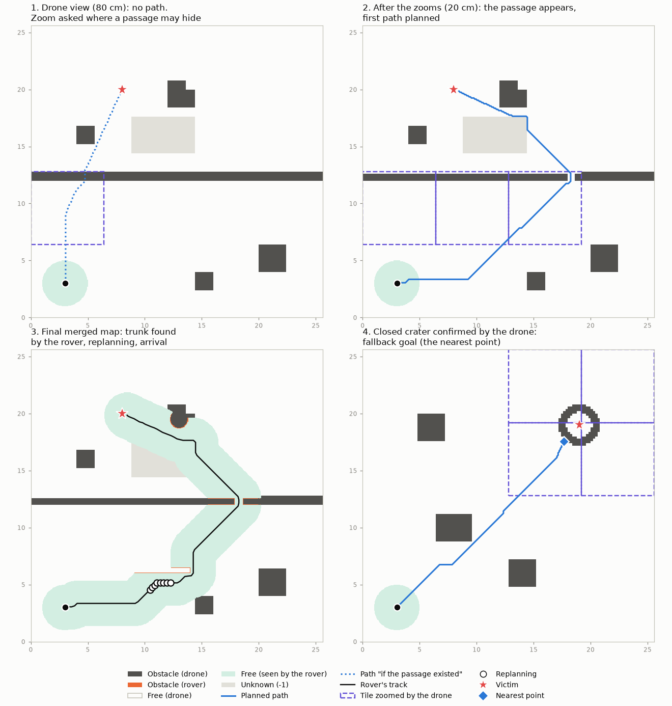

# merging_map: drone + rover map fusion

Merges the obstacle tiles sent by the drone and the rover into one map, plans a path with A*
and decides what to do when the rover is blocked.

| File | What it is |
|---|---|
| `fusion_carte.py` | The map: tile storage, fusion, A*, blocking decisions |
| `cerveau.py` | The brain: the mission loop (decide, drive, look, handle link losses) |
| `robot.py` | The interface between the brain and a rover, plus shared odometry bookkeeping |
| `mission_settings.py` | The mission's distances in two sets: `FIELD` (default) and `ARENA` (2.4 m demo) |
| `demo_fusion.py` | Simulated world and `Simu`, the simulated robot (needs `numpy` and `matplotlib`) |
| `rover_reel.py` | `RaspRoverReel`, the real RaspRover through its on-board server (**not yet tested on the robot**) |
| `lancer_overhead.py` | Real mission: live overhead camera as the drone + the real rover (`--dry-run` first) |
| `demo_fusion.png` | Output of the demo |
| `test_*.py` | pytest tests (map, simulation, real-rover adapter against a fake rover server) |
| `conftest.py` | Lets pytest import the modules from this folder |
| `dashboard/` | Replay dashboard (see below) |

## Architecture: one brain, two robots

```
                 cerveau.mission(robot, carte, ...)        <- runs on the ground computer
                         |   robot.Robot interface
           +-------------+--------------+
           |                            |
   demo_fusion.Simu              rover_reel.RaspRoverReel
   (simulated world,             (steps sent to the rover's own server, which drives:
    tests, dashboard)             rover/rover_server.py)
```

The brain only uses the `robot.Robot` interface: `position()`, `incertitude()`,
`deplacer(cible)`, `observer()`, `demander_zoom(tuile)`, `drone_disponible()`,
`rover_joignable()`, `attendre()`, `recaler()`… The same mission code therefore drives the
simulation and the real robot.

```python
from cerveau import mission
from fusion_carte import CarteFusion
from rover_reel import RaspRoverReel, client_http

carte = CarteFusion()
rover = RaspRoverReel(
    carte,
    client_http('http://<rover IP>:8080'),  # rover/rover_server.py on the rover (RDK X5)
    position_drone=...,  # -> (x, y, heading or None) of the rover seen from above, or None
    percevoir=...,  # -> (matrix -1/0/1, x0, y0): what the rover camera sees
    drone=...,  # object with disponible() and zoomer(tile) -> list of tiles
)
mission(rover, carte, depart=(3.0, 3.0), victime=(8.0, 20.0))
```

**Who does what.** The brain decides where to go; the rover's own server (RBDRB's
`rover/rover_server.py`) decides how. Each step of the path (about 30 cm) goes to the server
with `POST /path`, in the frame of its odometry (wheels + gyro); the server follows it and
stops. `POST /path` is in `main` (commit 5a7277d); an older server answers 404 and the
adapter says so. The server running on the robot has not been compared with the repository.

* **Two frames.** The adapter keeps the transform map <- odometry (rotation + translation).
  It is corrected only when the rover has **stopped**, on an image taken after the stop;
  while the rover moves, the position comes from the odometry. A slow camera therefore no
  longer makes false bumps.
* **Heading.** From the camera if it gives one; otherwise measured from a motion seen by both
  the camera and the odometry (a 15 cm straight line before the first step, then refined at
  every stop).
* **Bumps.** `stalled` from the server (wheels not turning), or wheels that spun while the
  camera saw the rover stay in place.
* **Links.** Only 2 s without any answer (`delai_liaison`) means "rover unreachable": a few
  answers lost on the Wi-Fi do not count, the server keeps driving meanwhile. An HTTP error
  (400, 404) raises `ServeurRoverError` instead of starting the recovery. When the link is
  really lost, the server finishes its current step and stops: there is no on-board return
  program, the brain waits for the link to come back.
* **Operator stop is final.** A step that ends `stopped` (STOP on the rover's page or the
  dashboard), `cancelled by manual control` (someone drives with the keyboard) or
  `replaced by a new command` (another client) without the adapter causing it raises
  `rover_reel.ArretOperateur`; the brain lets it through and `lancer_overhead.py` sends
  `/stop` and ends. Limit: a STOP pressed while the rover stands still between two steps
  leaves no trace in `/state` with today's server, so it is not seen.
* **Server restart.** Every `GET /state` is compared with the previous one: a new `boot_id`
  (or, on a server without it, `odom.odometer` or `link.rx_count` going down, which a
  `/reset_odom` also does) means the odometry restarted from zero. Before the next motion
  the adapter waits for the ESP32 and the gyro, re-anchors the map <- odometry transform on
  a fresh overhead image and measures the heading again if the camera does not give it.
* **Bounded steps.** A `/path` whose target is farther from the current odometry pose than
  the step the brain asked for plus `marge_pas` (0.2 m) is never sent:
  `ServeurRoverError`. (Before: 1.4 m driven for a 30 cm step after a restart.)
* **Heading move** is a `/path` to an absolute odometry point 15 cm ahead: sent again after a
  lost answer, it does not drive twice (a relative `/move` did). Backwards (front blocked)
  the rover turns on the spot, then drives 15 cm.
* **Small arena:** on the field, a real cut (2 s or more) makes the brain mark a 1.5 m no-go
  zone. In the 2.4 m arena that blocks almost everything (with the fake server, a 3 s cut
  ended the mission far from the victim), so the arena uses its own settings, without any
  no-go zone (see "Field and arena settings" below).
* **Tested against the real server code** (`test_rover_reel_banc.py`: `rover_server` +
  `rover_core` + simulated ESP32, in process): nominal step, operator STOP, manual takeover,
  restart between steps, bounded step.
* **Measured against the real server** in simulation (`rover_server.py --sim`, slope drift
  0.1 rad/s): the camera in a frame rotated by 30 degrees and shifted, taking an image every
  second on its own clock (so up to 1 s late), 1 cm noise, no heading. Arrived around a box,
  no false bump, 1 to 2 cm position error at each stop, 1 to 5 cm odometry drift during a
  step. That run checks the API, the frames and the slow camera; bumps (`stalled`, spinning
  wheels) and link losses are only tested against the fake server (`test_rover_reel.py`).
  The previous adapter, which trusted every image, made 4 false bumps and 35 to 54 cm of
  error with a camera at one image a second (in its own simulation).
* **The adapter relies on `/state` fields** that the rover README does not list:
  `ctrl.mode`, `ctrl.queued`, `ctrl.current`, `ctrl.history[0].status`, `odom.x`, `odom.y`,
  `odom.heading_deg`, `odom.gyro_ready`, `link.connected`, and, for restarts, `boot_id`,
  `odom.odometer`, `link.rx_count`. Changing them breaks the brain.
* Not yet run on the real robot. Its first move, when the camera gives no heading, is a
  15 cm straight line in an unknown direction.

## Field and arena settings

The distances of a mission come from `mission_settings.py`, in two sets.
`mission(..., settings=FIELD)` is the default (the simulation, the dashboard, a real mission
outdoors); `lancer_overhead.py` uses `ARENA` for the 2.4 m arena of the demo. Only what
depends on the size of the place changes; the rover and its sensors are the same:

| Setting | `FIELD` | `ARENA` | Why |
|---|---|---|---|
| `step` | 0.3 m | 0.2 m (to try) | the rover drives straight to the end of a step and cuts the path's corners inside it; obstacles are 30 to 40 cm apart |
| `careful_step` | 0.15 m | same | the rover |
| `drone_wait_max` | 300 s | same | time, not distance |
| `uncertainty_budget` | 0.6 m | 0.15 m | position error allowed without the drone, vs the passages (30 to 40 cm in the arena) |
| `link_backoff` | 0.5 m | 0 | rover link lost: how far back before the last connected point |
| `no_go_radius` | 1.5 m | 0 | outdoors a link loss comes from a place (behind a ridge); in a room it is a Wi-Fi glitch: no zone, just plan again |
| `check_horizon` | 3 m | 1 m | path ahead checked against new obstacles after each step |
| `inspect_reserve`, `inspect_max_distance` | 0.35, 1.2 m | 0.15, 0.6 m | where the rover stops to look at an obstacle itself (no drone) |

The `FIELD` values are the ones used so far: the simulation behaves exactly as before. The
`ARENA` values are orders of magnitude, to check on the first test drive with the real robot.
The rover radius and the planning cell size stay with the map (`REGLAGES_PETITE_ZONE`).

## With the overhead camera

The overhead camera pipeline (`guidance_global_map.drone.OverheadDrone`) plays the drone.
`lancer_overhead.py` wires it to the rover and runs a mission. Always run `--dry-run` first:
no POST leaves (the request function refuses them), it prints the zone in metres, the rover
pose seen by the camera, the scale, the first decision and the first steps, then stops.

```bash
export PYTHONPATH=merging_map:src/guidance_calib:src/guidance_global_map:src/guidance_rover_pose
python merging_map/lancer_overhead.py --camera 0 --metres-par-pixel 0.0021 --marqueur 10 \
    --victime 1.2 0.9 --rover http://<rover IP>:8080 --dry-run
# then the same without --dry-run; add --suivi /tmp/mission.json for a live page
```

| Option | What |
|---|---|
| `--camera SOURCE` | live overhead camera: index, `http(s)://` MJPEG or snapshot URL, `rtsp://`, file (`guidance_global_map.drone.camera_reader`) |
| `--image FILE` | still photo, **only with `--dry-run`** (it does not see the rover move) |
| `--dry-run` | no POST, stop after the first decision; `--rover` optional |
| `--metres-par-pixel M` | ground size of a pixel, measured with a ruler (best); otherwise `--hauteur`, `--focale-35mm`, `--capteur L H` |
| `--marqueur ID` | ArUco id on the rover (heading from the camera, no blind 15 cm move) |
| `--perception URL` | rover perception service (`perception_rover.percevoir_http`) |
| `--suivi FILE` | JSON document rewritten (atomically) after every decision and step |
| `--tolerance`, `--vitesse`, `--delai-http` | arrival distance (0.15 m), cruise speed (0.2 m/s), HTTP timeout (1 s) |

* **Before anything** `GET /state` must answer, or it stops with a clear message.
* **On every way out** (arrival, operator stop, error, Ctrl-C) it sends `POST /stop` (3 tries).

* **The adapter is used as asked**: first survey from `camera.tiles()`, rover position from
  `camera.rover_pose` (with or without a heading), `drone=camera`, `zone=camera.zone()`.
  The start defaults to where the camera sees the rover.
* **Small-area settings** (`REGLAGES_PETITE_ZONE`): `CarteFusion(niveau_plan=4,
  rayon_robot=0.155)`, i.e. 5 cm planning cells, and `tolerance=0.15`. `rayon_robot` is the
  radius of the circle around the whole rover: hypot(0.20, 0.23) / 2 = 0.152 m for the
  0.20 x 0.23 m rover, rounded up. The 0.115 in the overhead camera's doc is the half-length,
  which let a corner of the rover hit an obstacle when turning on the spot.
  Provisional until a test drive gives real numbers.
* **Frame**: the camera's, origin at the image's bottom-left corner, x right, y up, metres.
  Start and goal outside the camera's view are refused with a message saying so; tiles from
  the rover camera must use the same frame.
* Needs `src/guidance_*` on `PYTHONPATH` and `opencv-contrib-python`. Missions are tested with
  a fake camera that has the same methods (`test_lancer_overhead.py`,
  `test_lancer_mission_reelle.py`); the real `OverheadDrone` only in `--dry-run` on
  `data/overhead/synthetic_scene.png`. Nothing has run on the real robot yet.

**ROS node** (`src/guidance_supervisor`, `merging_map_node`): subscribes to `/map` and
`/rover/pose_overhead` (and `/goal_pose`, or the `goal_x` / `goal_y` parameters), runs the
fusion's planner about once a second and publishes `/fusion/map` (merged `OccupancyGrid`),
`/fusion/plan` (`nav_msgs/Path`) and `/fusion/decision` (JSON). It plans; it does not drive
the rover. The conversion logic is in `fusion_bridge.py` (no ROS, tested with plain pytest);
the node finds `merging_map/` by itself in the repo, or through `MERGING_MAP_PATH`.

```bash
ros2 run guidance_supervisor merging_map_node --ros-args -p goal_x:=1.2 -p goal_y:=0.9
```

The node itself has not been run: it needs the ROS container.

```bash
cd merging_map
python demo_fusion.py
```

The simulated rover camera:

* sees up to 2 m, in a cone of `champ` degrees centred on the rover's heading
  (`Simu(..., champ=160)`; 360 = all around, e.g. by turning the pan-tilt);
* **cannot see behind obstacles** (ray casting, first hit on each ray): hidden cells are sent
  as `-1`, exactly as the real rover must do. `occlusion=False` brings back the unrealistic
  "X-ray" camera for comparison;
* if the rover bumps into an obstacle it did not see, it stops 5 cm before it, reports it as
  an obstacle (as the real robot would from wheel slip on the encoders) and replans.

Three simulated terrains: `monde_1()` ridge with a hidden log, `monde_2()` closed crater,
`monde_3()` forest where the drone sees nothing under the trees.

A replay dashboard (drone + rover = merged maps, decisions step by step, field-of-view slider
with a comparison table) is in `dashboard/`:

```bash
python merging_map/dashboard/export_trace.py      # re-run after changing the module
python -m http.server 8765 --directory merging_map/dashboard
```



## Instructions for the rover team: tile format

* **N×N** matrix (N = 32), finest cell = **5 cm** (level z = 4).
* Values:
   * `1` = obstacle
   * `0` = free, **actually seen**
   * `-1` = not seen
* ⚠️ **"not seen" ≠ "free"**. Use `-1` for cells:
   * **behind any detected obstacle** (the camera can't see through it);
   * **beyond the camera's reliable range** (about 2 m);
   * anywhere you didn't look.

  If a hidden cell is sent as `0`, it **erases obstacles detected by the drone**.
* Tiles must be **aligned to the global grid** (drone / ArUco frame), not to the robot's frame.
* **Row 0 = south** (not the top, as in an image). Row i → +Y, column j → +X.
* Message:

  ```json
  {"source": "rover", "t": <seconds>, "z": 4, "x": <tx>, "y": <ty>, "data": [[...]]}
  ```

  Tile `(z, x, y)` covers `x*T <= X < (x+1)*T` and `y*T <= Y < (y+1)*T`, with
  `T = 32 × cell size` (1.6 m at z = 4).
* To split a large matrix into tiles, use `decouper()` in `fusion_carte.py`:

  ```python
  from fusion_carte import CarteFusion, decouper

  carte = CarteFusion()   # N = 32, finest cell 5 cm, zmax = 4
  # local: numpy matrix of -1/0/1 at 5 cm, whose cell [0][0] is at (x0, y0) in the global frame
  for msg in decouper(local, x0, y0, 4, carte, 'rover', t=now):
      send(msg)           # or carte.recevoir(msg) when testing locally
  ```
* For the pan-tilt camera, first send `{"T":900,"main":1,"module":2}` to the ESP32. The OLED
  should then show "RaspRover PT".

## How the fusion works

* The drone and rover tiles are stored separately: nothing the drone sends is ever deleted.
* In the merged view, a cell **seen by the rover** (`0` or `1`) wins over the drone; elsewhere the
  drone value stands. `-1` never changes anything.
* Within one source, the finest level and the most recent tile win.
* **Several devices per role**: `source` may also be `'drone:<id>'` or `'rover:<id>'` (any
  number of each; the role is the part before the colon). Each device's tiles are stored
  apart (`carte.tuiles['drone:a']`), then merged per role: the finest level wins, and at the
  same level the most recent tile wins; any rover still wins over every drone. Plain
  `'drone'` / `'rover'` behave exactly as before. `carte.sources('drone')` lists the devices.
* **Forgetting rover observations**: a rover cell wins over the drone for good, so a false
  bump (`stalled`, wheel slip) or a person in front of the rover camera can close a passage
  for the whole mission. `carte.oublier_rover(zone=(x0, y0, x1, y1))` (or `zone=None`:
  everywhere; `source='rover:b'`: one device) forgets them; the drone map takes over again.
  Bumps can also be given a lifetime: `carte.duree_choc = 30.0` (or
  `signaler_obstacle(..., duree=30.0)`, or `MissionSettings.bump_lifetime`), then
  `carte.expirer_chocs(t)` (called by the mission before every decision) erases them. Off by
  default: bumps last for good, as before.

## Using the module

```python
from fusion_carte import CarteFusion

carte = CarteFusion(n=32, res_fine=0.05, zmax=4)
carte.recevoir(msg)            # every tile received from the drone or the rover
carte.signaler_obstacle(x, y)  # wheel slip / stuck / slope too steep, felt by the rover
carte.oublier_rover(zone)      # forget what the rovers saw or felt there (false bump)

dec = carte.decider(rover_position, victim_position)
# dec['action'] is one of:
#   'SUIVRE'           -> dec['chemin']: list of (x, y) in metres
#   'DEMANDER_DRONE'   -> dec['tuiles']: [(z, x, y), ...] for the drone to fly over lower
#   'OBJECTIF_DEGRADE' -> dec['point']: closest reachable point to the victim, plus dec['chemin']

# after each step: does the next 3 m of the path still avoid every known obstacle?
if not carte.chemin_valide(remaining_path, horizon=3.0):
    dec = carte.decider(rover_position, victim_position)
```

Planning runs where the drone has surveyed (`carte.zone_survolee()`), stretched to include the
rover and the victim, so the rover does not wander off the map. Pass `zone=(x0, y0, x1, y1)` to
`decider()` to choose another area.

## Path planning and scales

* **A\*** on the z3 grid (10 cm cells), 8 directions (straight 1, diagonal 1.414, no corner
  cutting), straight-line heuristic, so the path is the shortest one. Unknown cells cost 3×,
  obstacles are grown by the robot radius (15 cm). Arrival = any free cell within 50 cm of
  the victim. If no free cell is that close (victim seen as an obstacle by the overhead
  camera, with the arena tolerance of 15 cm below the rover radius), arrival is any free cell
  just outside the inflation: tolerance + robot radius + drone margin + one cell.
* **Leaving the start**: when the rover stands inside the inflation (after a bump, or when
  the drone margin grew), the A\* lets it out only through cells at least as far from the
  nearest obstacle as the rover already is: it can back away, never get closer. When the
  rover stands outside the inflation nothing is released, so every vertex of the path keeps
  the robot radius. The path check after each step applies the same rule.
* Tile levels, 32×32 cells each: z0 = 80 cm cells (drone, first survey), z2 = 20 cm (drone
  zoom), z3 = 10 cm (planning), z4 = 5 cm (rover). One first-survey drone cell covers
  16 × 16 rover cells.
* Typical timings on a laptop (25.6 m area): one A\* ≈ 0.12 s, a full decision ≈ 0.16 s,
  the path check after each step ≈ 1 ms. Expect a few times slower on a Raspberry Pi.
* Field scale, measured on the VM (64 × 57.6 m surveyed at z4, 700 trunks): a 26 m path
  0.25-0.38 s; a victim that cannot be reached 0.32-0.48 s (0.55-0.63 s without the drone),
  instead of 4.3-5.6 s before; with a z0 survey (102 m area) 0.8-1.7 s instead of ~22 s.
  Reachability comes from connected components (OpenCV, `cv2.connectedComponents`) checked
  before the A\*, so a failing A\* no longer explores the whole map in Python. Without OpenCV
  the result is the same, only slower.

## When the drone link is lost

Everything runs on the ground computer, which sends orders to the drone and to the rover. If
the computer stops hearing from the drone (`decider(..., drone_disponible=False)`):

* **The rover keeps going, more carefully**: half speed, the drone map frozen as it was, its
  position from odometry only (wheels + IMU), with an uncertainty that grows with distance
  (2.5 cm per metre in the simulation). Drone obstacles get that much extra margin, except
  where the rover has looked closely itself (`carte.marge_drone`).
* **It does the drone's reconnaissance itself** (`action == 'INSPECTER'`): when no path exists,
  the module asks where a passage could hide under an obstacle only seen from far away, and
  sends the rover to look from about 1 m away (`cible`, `point_de_vue`). A 360° look with the
  pan-tilt follows; the sector is then marked inspected and the search moves on.
* **Too uncertain** (over 60 cm): if the victim is closer than the last point seen by the
  drone, it carries on and stays with the victim; otherwise it goes back along its own trace
  and waits for the drone. Without the drone, "no passage" is never final: it waits for it.
* **When the drone comes back**, it sees the rover's marker: the position is corrected, and
  everything the rover saw meanwhile is rewritten at the right place (error spread along the
  path), which removes the "ghost" obstacles written at the wrong position
  (`instantane_rover()` / `restaurer_rover()`).

In the simulation: `Simu(..., coupures=[(t0, t1)])` cuts the link (`t1=None`: for good);
`monde_4()` and `monde_5()` are the drone-loss scenarios.

## When the rover link is lost

If the computer can no longer talk to the rover (a radio dead zone), nobody sends it orders
any more, so the way back has to be done **by the rover itself**: a small safety program on
the rover's computer (RDK X5), not the whole module. The drone keeps seeing the rover meanwhile, so the computer
still knows where it is.

1. No order from the computer for 1 s: the rover records the exact moment and the **last point
   where the link still worked**, stops, and keeps what its camera sees on board.
2. It drives back along its own trace to 50 cm before that point; the link comes back.
3. It sends what it saw during the cut. The computer marks the area where the link was lost
   as a **no-go zone** (`carte.interdire_zone(x, y, r)`: a circle of 1.5 m just past that
   point; none with the `ARENA` settings, where a lost link is a Wi-Fi glitch). The A\* treats it like an obstacle, but it stays out of the obstacle tiles, so the
   drone does not try to zoom on it and it can be removed later (radio relay).
4. The module plans again with the global map and the drone. If the new path enters the dead
   zone somewhere else, the same thing happens and the zone is mapped bit by bit.

In the simulation: `Simu(..., zones_blanches=[(x, y, r)])`; `monde_6()` is the scenario.

**Still to do on the real robot:** the on-board safety program (a watchdog in the rover's
server, `rover/rover_server.py`: record the odometry trail and the link state, and drive back
on it when the computer goes silent). Today that server finishes its current step and stops,
and the brain waits for the link to come back (`attendre_retour_embarque`, 60 s by default
in `RaspRoverReel(delai_retour=...)`). If it does not come back, the mission ends with
`abandon: rover injoignable` (it never logs "link back" when it is not).

## How a mission ends

`cerveau.mission()` returns its snapshots with the outcome:

| `instantanes['issue']` | meaning | `ETAT_SUIVI` (live page) |
|---|---|---|
| `arrivee` | at the victim (`instantanes['succes']` is True only here) | `arrive` |
| `objectif_degrade` | no passage: closest reachable point, alert | `abandon` |
| `abandon_drone` | no drone for `drone_wait_max`: stopped, alert | `abandon` |
| `rover_injoignable` | rover link lost and not back after the adapter's wait | `abandon` |
| `sans_progres` | rover did not move more than `stall_distance` (5 cm) over `stall_steps` (8) steps, or bumped `same_bump_max` (4) times at one place | `abandon` |
| `max_tours` | `max_tours` turns without an end | `abandon` |
| `erreur_robot` | `robot_error_retries` (3) rover server errors in a row | `erreur` |

`instantanes['raison']` says why in words. A rover server error (`ServeurRoverError`, e.g. the
heading could not be measured because the overhead camera missed the rover) stops the rover,
waits 1 s and tries the step again; an operator stop (any exception named `ArretOperateur`)
is never retried: it goes straight to the caller.

When no path exists, the module asks: "if the obstacles the drone only saw from far away were
actually passable, where would I go?" It then asks the drone to zoom on exactly those tiles. If
the drone confirms they are blocked, the rover goes to the closest reachable point and raises
the alert.

## Known problems

### The victim is seen as an obstacle

The overhead camera (or the drone) sees the victim as an object, so it is an obstacle on the
map, grown by the rover radius like any other. Arrival means "a free cell within `tolerance`
of the victim point", and those cells are all inside the grown victim:

* with the arena settings (`tolerance=0.15`, `rayon_robot=0.155`) no cell can ever count as
  arrived: the brain ends in `OBJECTIF_DEGRADE` ("AUCUN PASSAGE") next to the victim;
* with the field tolerance (0.5 m, `rayon_robot=0.15`) it only works if the edge of the victim
  is less than about 35 cm from the victim point.

The victim must not be made "free": the rover would drive over it. What is wrong is the
definition of arrival. Planned fix:

* arrival at contact: any free cell within *victim radius + `rayon_effectif` + tolerance* of the
  victim point;
* the victim radius measured on the map: the group of obstacle cells that touches the victim
  point, capped at about 0.5 m so that a wall is not taken for the victim (beyond that, the
  closest reachable point, as today);
* later, a "victim" class sent by the camera (e.g. an ArUco marker on the victim), which needs
  a change of the tile format.

Partly done (real-hardware integration, 15 Nov): an arrival cell may now be up to
*tolerance + `rayon_effectif` + drone margin + one cell* from the victim point, so a victim
object whose edge is within about tolerance + one cell (0.20 m in the arena) of the victim
point is reached with `SUIVRE` (`test_fusion_reel.py`, a 10 cm object). The measured victim
radius above is not done: a larger victim still ends in `OBJECTIF_DEGRADE`.

### A false bump stays for the whole mission

A bump (`stalled` from the server, or wheels that spun while the camera saw the rover stay in
place) is written by `signaler_obstacle()` into the rover's tiles, always as the newest data,
and the rover wins over the drone. With `lancer_overhead.py` and no `percevoir`, the rover
sends no tiles of its own, so nothing ever writes those cells again: a false bump (a carpet
edge, a low battery, a camera error taken for a spin) closes that passage until the end of the
mission. Planned fix:

* bumps in a layer of their own (x, y, radius, time, number of hits), added to the planning
  grid as blocked instead of being written into the tiles, so that they can be removed;
* a first bump is provisional, a second one within about 15 cm makes it final; a provisional
  bump is dropped when no path exists without it, and the rover tries again at `careful_step`;
* the cells the rover's body actually drove over are free (swept footprint);
* in the arena, the overhead camera (which sees everything) may clear a provisional bump when
  it sees free floor there after the bump. Not on the field: a bump exists precisely because
  the drone does not see that obstacle. A `mission_settings` value.

Partly done (real-hardware integration, 15 Nov): `MissionSettings.bump_lifetime` (off by
default) makes a bump expire after that many seconds, and `CarteFusion.oublier_rover(zone,
source)` forgets the rover's observations. The separate bump layer above is not done.

### Before the first real mission

* `rover_reel.py` has never driven the real rover: stall detection, gyro and `/path` timings
  are only checked against `rover_server.py --sim` and the fake server.
* Live reader for the overhead camera: done since this list was written
  (`guidance_global_map.drone.camera_reader`, used by `lancer_overhead.py --camera`, and
  `drone.LiveCamera`), never tried on a real stream.
* Provisional values to measure on site: `rayon_robot` (0.155 m), the `ARENA` settings, the
  arrival tolerance (0.15 m), the camera height (`--hauteur`, 1.9 m) and the ArUco marker that
  gives the rover's heading.
* The live fusion on the forest simulation (`sim/fusion_live.py`) is open loop: the simulated
  rover drives its own route, the brain has never driven it there.

## Tests and lint

```bash
pytest merging_map                     # numpy only; matplotlib is needed only for the figure
PYTHONPATH=src/guidance_supervisor pytest src/guidance_supervisor/test/test_fusion_bridge.py
ruff check . && ruff format --check .
```

Outside the ROS container, run `pytest merging_map` rather than a bare `pytest` at the root,
which stops on the ROS packages.

Code comments and identifiers are in French.
